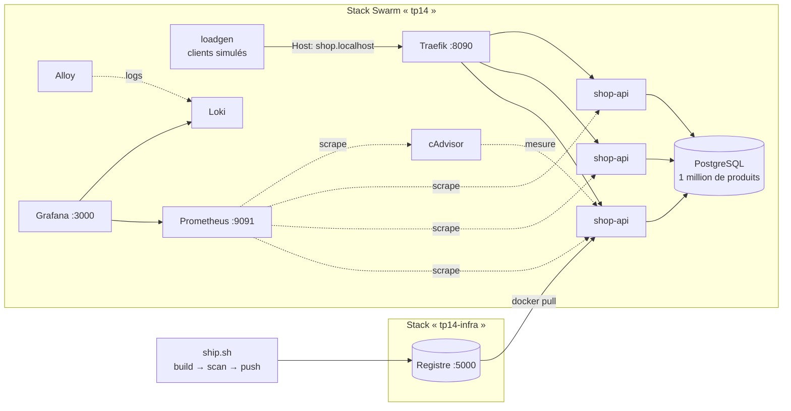

# TP14 — Projet final : reprendre une plateforme en production

> Durée estimée : 3 h · Ports utilisés : `5000` (registre), `8090` (boutique via Traefik), `8091` (dashboard Traefik), `9091` (Prometheus), `3000` (Grafana), `8080` (cAdvisor)
> Prérequis : **tout le parcours**, en particulier TP06 (multi-stage), TP09 (registre), TP10 (scan), TP11 (observabilité), TP12 (Swarm + Traefik) et TP13 (chaîne de livraison).
> Machine avec **~6 Go de RAM libres** recommandés (une douzaine de conteneurs).

## 🎬 Le contexte

Un prestataire vient de livrer **Telemach Shop**, la boutique en ligne de l'entreprise : une API catalogue en Go, adossée à PostgreSQL. Son mot d'ordre : « Ça marche sur mon poste. » Son contrat s'arrête là.

**Lundi, la boutique part en production. Vous êtes l'équipe d'exploitation.** Votre mission, dans l'ordre où elle se présente dans la vraie vie :

1. **Livrer** proprement : une image durcie, scannée, versionnée, publiée dans le registre de l'entreprise.
2. **Déployer** sur le cluster Swarm, derrière Traefik, en plusieurs réplicas.
3. **Rendre observable** : métriques, logs et tableau de bord, pour ne pas être aveugle.
4. **Tenir la première semaine** : les tickets d'incident tombent. À vous de diagnostiquer, de corriger et de **prouver** que c'est réglé.

Rien n'est nouveau dans ce TP : tout a été vu dans les TP précédents. Ce qui est nouveau, c'est de **tout faire tenir ensemble**, sur une application que vous n'avez pas écrite, avec des problèmes qu'on ne vous désigne pas.

## 🎯 Objectif vérifiable

`./verify.sh` rejoue toute l'histoire, de bout en bout, et contrôle :

- **Livraison** : une image `shop-api` de **moins de 30 Mo**, **non-root**, **0 faille HIGH/CRITICAL**, publiée en `1.0.0` dans le registre, sans aucun tag `latest`.
- **Déploiement** : une stack Swarm où l'API tourne en **3 réplicas** tirés **depuis le registre**, et répond via Traefik.
- **Observabilité** : Prometheus voit **chaque** réplica, Grafana est provisionné, les logs arrivent dans Loki.
- **Incidents** : les 4 tickets sont corrigés, dont une **mise à jour 1.0.0 → 1.1.0 sous charge sans une seule erreur**.

---

## L'architecture



| Fichier / dossier | Rôle | Vous y touchez ? |
|---|---|---|
| `app/` | Le code de l'API, livré par le prestataire | ❌ À **lire**, pas à modifier |
| `loadgen/` | Les clients simulés de la boutique (trafic réaliste) | ❌ |
| `starter/Dockerfile` | L'image de l'API, telle que livrée | ✅ Phase 1 |
| `starter/ship.sh` | La chaîne de livraison : build → scan Trivy → push | ❌ À lire |
| `starter/registry.yml` | Le registre privé (stack d'infrastructure) | ❌ |
| `starter/stack.yml` | La stack de production | ✅ Phase 2 puis incidents |
| `starter/prometheus/`, `alloy/`, `grafana/` | L'observabilité (cf. TP11) | ✅ Phase 3 |
| `starter/db/init.sql` | Schéma et données de la base | ✅ Incidents |
| `incidents/` | Les tickets de la semaine | 📖 Phase 4 |

> ⚠️ Toutes les commandes se lancent **depuis `starter/`** : `stack.yml` monte des fichiers par chemin relatif (`./db`, `./prometheus`…).

---

## Étape 0 — Un cluster

```bash
cd starter
docker swarm init          # si ce n'est pas déjà fait (cf. TP12)
docker node ls             # vous êtes Leader
```

---

## Phase 1 — Livrer (registre + scan)

### Étape 1 — Démarrer le registre de l'équipe

Le registre est une **infrastructure partagée** : on le déploie dans sa propre stack, **avant** l'application. On pourra ainsi détruire et redéployer l'appli autant de fois qu'on veut sans perdre les images publiées.

```bash
docker stack deploy -c registry.yml tp14-infra
curl -s http://localhost:5000/v2/_catalog        # -> {"repositories":[]}
```

### Étape 2 — Tenter de livrer l'image du prestataire

Lisez `ship.sh` : il **construit** l'image, la fait **scanner** par Trivy, et ne la **pousse** que si le scan ne trouve aucune faille HIGH ou CRITICAL (le garde-fou du TP13, sans Jenkins). Livrez d'abord le générateur de trafic, déjà propre, puis l'API :

```bash
./ship.sh loadgen 1.0.0
./ship.sh shop-api 1.0.0
```

> ❓ **Question** : `loadgen` passe, `shop-api` est **refusée**. Combien pèse l'image refusée (`docker image ls`) ? D'où viennent ses failles : du code Go, ou de ce qu'il y a **autour** ? Qui est l'utilisateur du processus (`docker image inspect -f '{{.Config.User}}' ...`) ?

### Étape 3 — Durcir l'image, puis livrer

Corrigez `starter/Dockerfile` (**TODO 1 et 2**) en appliquant les TP06 et TP10 : **multi-stage**, binaire **statique**, image finale **minimale**, utilisateur **non-root**. Puis relivrez :

```bash
./ship.sh shop-api 1.0.0
curl -s http://localhost:5000/v2/telemach/shop-api/tags/list    # -> {"tags":["1.0.0"]}
```

> 🧠 Trivy ne regarde pas que les paquets de l'OS : il lit aussi les **dépendances embarquées dans le binaire Go** (section `gobinary` de son rapport). Une image distroless peut donc encore être refusée, à cause d'une bibliothèque tirée **indirectement** par une autre. Le correctif se fait alors dans `go.mod`, pas dans le Dockerfile. C'est arrivé pendant l'écriture de ce TP : `golang.org/x/text`, tirée par le pilote PostgreSQL.

> 🧠 La version est un **paramètre de livraison** (`ARG VERSION`, injecté dans le binaire) : la même source donne `1.0.0` aujourd'hui, `1.1.0` demain. Et **jamais** `latest` : `ship.sh` le refuse, car un `latest` ne dit pas **quelle** version tourne en production.

---

## Phase 2 — Déployer sur Swarm

### Étape 4 — Reprendre la stack du prestataire

Ouvrez `starter/stack.yml`. La base, Traefik, `loadgen` et toute l'observabilité sont fournis. Le service `shop-api` est à reprendre :

- **TODO 1** : l'image vient du **registre**, pas du poste du prestataire : `localhost:5000/telemach/shop-api:${SHOP_VERSION:-1.0.0}` ;
- **TODO 2** : **3** réplicas ;
- **TODO 3** : les labels Traefik (cf. TP12) pour router `Host(\`shop.localhost\`)`.

```bash
SHOP_VERSION=1.0.0 docker stack deploy -c stack.yml tp14
docker stack services tp14            # attendez que tout soit en N/N (1 à 2 min)
docker service ps tp14_shop-api       # colonne IMAGE : d'où vient l'image ?
```

> 🧠 Différence avec le TP12 : plus besoin de `--resolve-image=never`. L'image est dans un **registre** : Swarm interroge le registre, **épingle le digest** exact (`docker service inspect tp14_shop-api`) et chaque nœud la **tire** lui-même. C'est ce qui rend un cluster **multi-nœuds** possible.

### Étape 5 — Ouvrir la boutique

```bash
curl -s -H 'Host: shop.localhost' 'http://localhost:8090/products?category=cat-07' | head -c 300; echo
curl -s -H 'Host: shop.localhost' http://localhost:8090/version
docker service logs --tail 5 tp14_loadgen          # les clients simulés sont déjà là
```

`loadgen` envoie en continu un trafic réaliste (navigation, fiches produit, commandes). **La boutique est ouverte, et la production commence à vivre…**

> ⏱️ Dès maintenant, des incidents peuvent apparaître d'eux-mêmes. C'est voulu : continuez la phase 3, ils vous attendront.

---

## Phase 3 — Rendre observable

### Étape 6 — Le tableau de bord

Ouvrez **Grafana** (http://localhost:3000, `admin` / `admin`, puis **Skip**) → **☰ ▸ Dashboards ▸ Telemach Shop ▸ Telemach Shop — production**. Il est **provisionné** : rien à créer.

Il suit la méthode **RED**, celle qu'on regarde en premier pendant un incident : **R**ate (débit), **E**rrors (erreurs), **D**uration (latence). En dessous : les ressources des réplicas (cAdvisor), l'état interne de l'appli et les logs d'erreur (Loki).

### Étape 7 — Un tableau de bord qui ment

Regardez le panneau **Requêtes/s par réplica**.

> ❓ **Question** : vous avez **3** réplicas. Combien de courbes ? Allez dans Prometheus (http://localhost:9091, **Status ▸ Target health**) : combien de cibles pour le job `shop-api` ? Rafraîchissez plusieurs fois http://localhost:9091/api/v1/query?query=shop_build_info : l'étiquette `instance` change-t-elle ? Les compteurs sont-ils cohérents d'un scrape à l'autre ?

Le problème est dans `starter/prometheus/prometheus.yml`. En Swarm, `shop-api` désigne l'**IP virtuelle** (VIP) du service (cf. TP12) : à chaque scrape, Swarm redirige Prometheus vers **un réplica au hasard**. Trois réplicas se font passer pour une seule cible, et les courbes deviennent du bruit.

Corrigez le job `shop-api` pour que Prometheus découvre **chaque réplica** par DNS. Le DNS de Swarm répond à `tasks.<service>` avec l'IP de **chaque** tâche (voir `dns_sd_configs` dans « Où chercher »). Faites de même pour `loadgen`, puis rechargez Prometheus :

```bash
curl -X POST http://localhost:9091/-/reload
```

Vous devez obtenir **3 cibles** `shop-api` en **UP**, et 3 courbes dans Grafana.

> 🧠 Retenez ce réflexe : **un service répliqué ne se supervise pas par son nom de service**. On veut voir les instances une par une, puisque c'est **une** instance qui fuit, sature ou plante.

---

## Phase 4 — La semaine d'incidents

Les tickets sont dans [`incidents/`](incidents/). Ils décrivent un **symptôme**, comme le ferait un utilisateur. **Pas la cause.** Traitez-les **dans l'ordre** :

| Ticket | Symptôme rapporté | Priorité |
|---|---|---|
| [INC-101](incidents/INC-101.md) | « La recherche par catégorie rame » | 🟠 P2 |
| [INC-102](incidents/INC-102.md) | « Les API redémarrent toutes seules » | 🔴 P1 |
| [INC-103](incidents/INC-103.md) | « Des erreurs 500 depuis qu'on est passé à 6 réplicas » | 🔴 P1 |
| [INC-104](incidents/INC-104.md) | « Chaque mise en prod fait des erreurs pendant 30 secondes » | 🟠 P2 |

### La méthode, pour chaque ticket

1. **Observer** : le dashboard, les logs, `docker service ps`. Que disent les **chiffres** ?
2. **Formuler une hypothèse**, et une seule à la fois.
3. **La vérifier** avant de corriger quoi que ce soit (un `EXPLAIN`, un calcul, une reproduction).
4. **Corriger** dans les fichiers de la stack (`stack.yml`, `db/init.sql`…), jamais seulement « à la main » sur un conteneur : un correctif qui n'est pas dans un fichier versionné **disparaîtra** au prochain déploiement.
5. **Prouver** que c'est réglé : le critère de clôture du ticket, chiffres à l'appui.

Chaque ticket propose **trois indices** de plus en plus précis, dans des blocs repliés. Résistez à la tentation : le diagnostic **est** l'exercice.

Après chaque modification de `stack.yml`, redéployez avec la **même** commande. Swarm n'applique que les différences :

```bash
SHOP_VERSION=1.0.0 docker stack deploy -c stack.yml tp14
```

> 🧠 Aucun ticket ne demande de modifier le code Go de `app/`. C'est la réalité de l'exploitation : on corrige **l'image, le déploiement, la configuration et la base**, et on **remonte** le reste au développeur (chaque ticket le signale).

---

## Phase 5 — Valider, puis rédiger

### Étape 8 — Validez

```bash
cd ..
./verify.sh              # teste VOTRE travail (dossier starter/)
./verify.sh solution     # (option) rejoue la solution de référence
```

> ⚠️ `verify.sh` **repart de zéro** : il supprime vos stacks `tp14` et `tp14-infra` et leurs volumes, puis rejoue toute l'histoire (livraison, déploiement, charge, pic de trafic, mise à jour sous charge). Comptez **~10 minutes**.

### Étape 9 — Le post-mortem

Choisissez **un** incident et rédigez son post-mortem à partir du modèle [`incidents/POST-MORTEM-modele.md`](incidents/POST-MORTEM-modele.md). Une page, **sans reproche**. Si vous êtes en groupe, échangez-les : chaque équipe a souvent trouvé le problème par un chemin différent.

### Étape 10 — Démontez

```bash
cd starter
docker stack rm tp14 tp14-infra
sleep 15
docker volume rm tp14_db-data tp14-infra_registry-data tp14-trivy-cache   # ⚠️ supprime la base, les images publiées et le cache Trivy
docker swarm leave --force                                                # ⚠️ quitte le mode Swarm
```

---

## 💡 Indices

<details>
<summary>Phase 1 — Le Dockerfile durci</summary>

```dockerfile
FROM golang:1.27-alpine AS build
WORKDIR /src
COPY go.mod go.sum ./
RUN go mod download
COPY *.go ./
ARG VERSION=dev
RUN CGO_ENABLED=0 go build -trimpath -ldflags "-s -w -X main.version=${VERSION}" -o /out/shop-api .

FROM gcr.io/distroless/static-debian13:nonroot
COPY --from=build /out/shop-api /shop-api
USER nonroot:nonroot
EXPOSE 8080
ENTRYPOINT ["/shop-api"]
```
</details>

<details>
<summary>Phase 2 — Le service shop-api repris</summary>

```yaml
  shop-api:
    image: localhost:5000/telemach/shop-api:${SHOP_VERSION:-1.0.0}
    environment:
      DB_HOST: db
      DB_NAME: shop
      DB_USER: shop
      DB_PASSWORD: shoppass
    deploy:
      replicas: 3
      resources:
        limits:
          cpus: "0.50"
          memory: 128M
      labels:
        - traefik.enable=true
        - traefik.http.routers.shop.rule=Host(`shop.localhost`)
        - traefik.http.routers.shop.entrypoints=web
        - traefik.http.services.shop.loadbalancer.server.port=8080
```
</details>

<details>
<summary>Phase 3 — Découvrir chaque réplica</summary>

```yaml
  - job_name: shop-api
    dns_sd_configs:
      - names: ["tasks.shop-api"]
        type: A
        port: 8080
```
</details>

<details>
<summary>shop-api reste à 0/3 ?</summary>

`docker service ps tp14_shop-api --no-trunc` : la colonne `ERROR` dit tout. Causes fréquentes :
- `No such image` : l'image n'est pas dans le registre (`./ship.sh` a-t-il **réussi** ?) ou le nom dans `stack.yml` ne correspond pas exactement ;
- la tâche redémarre en boucle : `docker service logs tp14_shop-api`.
</details>

<details>
<summary>Grafana affiche « No data » ?</summary>

Vérifiez les cibles dans Prometheus (**Status ▸ Target health**). Après une modification de `prometheus.yml`, pensez au `curl -X POST http://localhost:9091/-/reload`. Les panneaux cAdvisor (mémoire, CPU) mettent ~30 s à se remplir.
</details>

---

## 📖 Où chercher (documentation officielle)

- **Swarm, stacks et services** : https://docs.docker.com/engine/swarm/stack-deploy/ · https://docs.docker.com/reference/compose-file/deploy/
- **Réseau Swarm (VIP, DNS `tasks.`)** : https://docs.docker.com/engine/swarm/networking/
- **Registre privé** : https://distribution.github.io/distribution/ · https://docs.docker.com/engine/swarm/stack-deploy/#set-up-a-docker-registry
- **Multi-stage et images distroless** : https://docs.docker.com/build/building/multi-stage/ · https://github.com/GoogleContainerTools/distroless
- **Trivy** : https://trivy.dev/latest/docs/target/container_image/
- **Prometheus, découverte DNS** : https://prometheus.io/docs/prometheus/latest/configuration/configuration/#dns_sd_config
- **Méthode RED** : https://grafana.com/blog/2018/08/02/the-red-method-how-to-instrument-your-services/
- **LogQL (Loki)** : https://grafana.com/docs/loki/latest/query/
- **Traefik, provider Swarm** : https://doc.traefik.io/traefik/providers/swarm/

---

## 🚀 Pour aller plus loin

1. **INC-105 (bonus) : « Tout est lent, le CPU est à 100 % ».** Passez la limite CPU de `shop-api` à `cpus: "0.10"`, redéployez sous charge et observez le panneau **CPU bridé (throttling)**. Le CPU **semble** bas sur l'hôte, et pourtant tout est lent. Pourquoi ? Quelle valeur choisir, et comment la justifier avec les chiffres ?
2. **Alerter au lieu de regarder.** Écrivez une règle d'alerte Prometheus qui se déclenche quand un réplica dépasse 80 % de sa limite mémoire, **avant** l'OOM. Où la brancher ?
3. **Secrets Swarm.** Remplacez `DB_PASSWORD` / `POSTGRES_PASSWORD` en clair par un `docker secret` (cf. TP12, « Pour aller plus loin »). L'image `postgres` lit `POSTGRES_PASSWORD_FILE`. Que faudrait-il ajouter à l'API ?
4. **Signer ce qu'on livre.** Ajoutez à `ship.sh` la génération d'un **SBOM** (`trivy image --format cyclonedx`) et une signature `cosign`. Qu'est-ce que cela prouve que le scan ne prouve pas ?
5. **Le vrai cluster.** Rejouez le TP sur le cluster Docker-in-Docker de l'Annexe A du TP12. Qu'est-ce qui casse ? (Indices : `localhost:5000` n'est plus le même registre pour chaque nœud ; le volume de la base est local à son nœud.)
6. **Le correctif de fond.** Vous êtes maintenant le développeur : corrigez la clé de cache (INC-102) et la transaction tenue pendant l'appel de paiement (INC-103) dans `app/main.go`, livrez une 1.2.0, et mesurez la différence sur le dashboard.

---

<div align="center">

**[Telemach Learning](https://www.telemach-learning.fr)** — Formations DevOps, Cloud & Conteneurs

🌐 [www.telemach-learning.fr](https://www.telemach-learning.fr)

© 2026 Telemach Learning — Code formation DEVOPS-001

</div>
